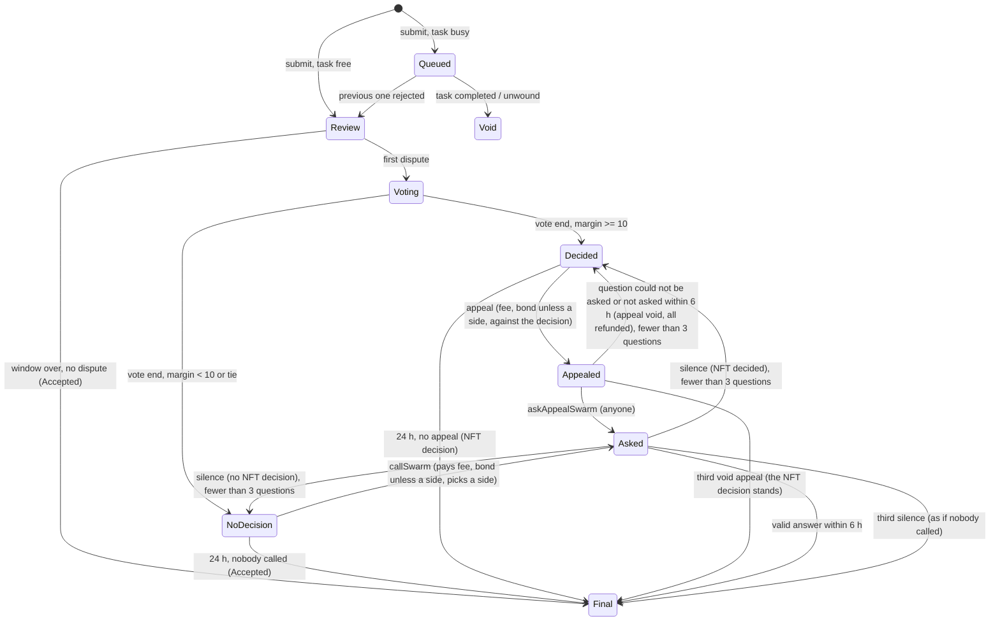

# moneycanbuy.fun mechanics (TaskVault)

The rules as the code enforces them, with a code reference for each one. References are `src/<file>.sol`
(function or constant name) written short: paths are relative to `src/` unless they start with
`script/` or `test/`. Values are the launch values (registry version 1, `VaultParams.sol`). The
project token $YOLO (supply, uses, buy guard, vesting, pool, price as a reward currency) has its own page:
`docs/YOLO.md`.

## Overview

An author locks a reward of at least a per-currency minimum (5 USDC, 0.002 ETH, 1 IMD, 1,000 YOLO), with no maximum,
in ETH, USDC, IMD or the project token $YOLO for a task written from a template, with a deadline; the reward stays
locked until that deadline. A doer submits one proof link and a bond (0.5 IMD plus 3% of the author's reward in its currency); one submission is judged at a time, the
rest wait in a queue. If nobody disputes within 24 h, the doer gets the reward minus 10% (a doer with a $YOLO lock
gets up to 4% of it back). Anyone but the doer can dispute with a bond (0.5 IMD plus 1% of the author's reward in its currency) (the first to dispute is the disputer; a
second dispute is rejected). Disputes go to a vote of identity.md NFT holders: each voter sends their own
vote and pays their own gas. Their decision can be appealed to the IMD swarm, and when they do not decide anyone can
call the swarm. The swarm's answer is final; a silent swarm reopens the window, at most three questions per
submission. The losing side's bonds pay the winners and the NFT voters who were right. Of the 10% fee, 5% goes to
the NFT voters who were right and the rest to the treasury. With a staked doer the bonus comes from the other 5%,
the unearned NFT 5% burns and the rest of the other 5% goes half to the burn, half to the treasury. All payouts are pulled. The dev wallet may cancel a task; all money goes back to those who put it in,
except swarm fees already paid; it takes nothing for itself. Parameters are fixed per task at creation (the version in effect at that moment), within hard bounds in code.

## Participants

| Who | Can do | Code |
|---|---|---|
| Author | `createTask` with reward, deadline, title, condition, category, proof type, cover; is the first contributor | `TaskVault.sol` |
| Contributor (incl. author) | `topUp` the reward (same currency, before the deadline); `withdrawContribution` once the task is Expired or Unwound | `TaskVault.sol` |
| Doer | `submit` proof + bond; `claimVoidSubmission` if their queued submission never ran | `desks/CaseDesk.sol` |
| Disputer (anyone but the doer, incl. the author) | `dispute` once per submission while the dispute window is open; `claimDisputer` after the end | `desks/DisputeDesk.sol` |
| NFT holder / delegate | sends their own `vote(subId, side, payTo, tokenIds)` transaction (via the vault), paying their own gas; `claimVoterReward` goes to the named `payTo` | `VotePower.sol`, `desks/DisputeDesk.sol` |
| Appellant / swarm caller (anyone) | `appeal` an NFT decision, or `callSwarm` when there is none, paying bond + live swarm fee; the doer or the disputer calling for their own side posts no second bond (the fee comes out of their bond, a repeat call's fee from the wallet); `askAppealSwarm` (anyone) asks a filed appeal | `desks/DisputeDesk.sol` |
| IMD swarm (Intake) | answers yes/no through `onOracleResult` only (no public fallback) | `TaskVault.sol` |
| Treasury | receives its part of the fee (non-$YOLO); pays for nothing; `sweepTreasury` (anyone) credits it, then it withdraws | `TaskVault.sol` |
| Staked doer (`YoloLockHub`) | `lock(add, weeks)` $YOLO for 1-52 weeks, `withdraw` after the end; the lock's power (fixed at the lock) at their submission, against the reward in $YOLO, sets the doer bonus | `YoloLockHub.sol`, `desks/CaseDesk.sol`, `desks/DisputeDesk.sol` |
| Dev wallet (`0x8Ad18E99F4C8d8406f9Ba8899CF308000518A981`, the DevPrices owner) | `cancelTask(taskId)` of an Open task: Unwound in any open phase, all money goes back to those who put it in except swarm fees already paid, each claims their own; the dev wallet takes nothing for itself. Also sets the prices (`DevPrices`) and the buyback wallet (`BuybackBurner.setBuybackWallet`) | `TaskVault.sol` `cancelTask`, `DevPrices.sol`, `BuybackBurner.sol` |
| Anyone, for the `BuybackBurner` | `burnYolo` ($YOLO to `0x…dEaD`), `forward` (ETH, USDC, IMD to the buyback wallet), `pull`; nobody is paid for calling | `BuybackBurner.sol` |
| NFT holder / delegate (moderation) | `vote` to hide or keep a task or proof on the site (separate from dispute voting above): 24h round, passes at >= 10 hide NFTs, more hide than keep, >= 3 distinct hide owners; the 7-day cooldown after a contested round only bites once the hide side itself reached the full hide quorum (10 NFTs from 3 distinct owners, the same bar a round passes at); the project wallet sets the state at once with `setState` | `HiddenList.sol` |
| Anyone | `poke` (play timers), `sweepTreasury`, `withdraw` own credits; the burner's Burn and Send buttons on the site | `TaskVault.sol` |

## Task lifecycle

- **Create.** Currency ETH, USDC, IMD or $YOLO; the deadline is required and in the future, a zero deadline reverts
  `BadDeadline`; title 1..64 bytes, three rule texts of 1..512 bytes each (text rule below), category < 9, proof type < 4, cover
  empty / `ipfs://…` / `https://…` ≤ 160 bytes; amount 1..2^128-1. No price is read at creation: a task is created
  in any of the four currencies whatever the price parameters say. The minimum reward is four separate per-currency parameters (5
  USDC, 0.002 ETH, 1 IMD, 1,000 YOLO); there is no maximum, on one task or across all open tasks. There is no
  creation fee (`createTask` takes none). ETH comes in `msg.value`,
  USDC and $YOLO by `transferFrom`, IMD by `transferFrom` or a swap. Title and cover live only in the `TaskCreated`
  event; nothing set here can change later. The task stores its creation time (`createdAt`, used by YOLO Predict
  weights). Task creation can be paused.
- **Top up.** Same currency, task Open, before the deadline, no contributor fee. It joins the reward at once, also while a submission is being checked: an accepted submission takes it.
- **The reward is locked until the deadline.** Nobody who put money into a task, the author included, takes it back
  while the task is Open, before or after its deadline (`withdrawContribution` reverts `TaskNotOpen`). Expired or
  Unwound: everyone takes back their share; Completed: nothing (the whole pot went to the doer). The pot can never fall below what it was at creation while the task is
  open.
- **Deadline.** Required, never changes. Closes `submit` and `topUp`, and YOLO Predict positions. An active
  submission and the whole queue are still judged to the end. The task becomes **Expired** only when the deadline
  passed and no submission is active; then everyone withdraws their share.
- **Statuses:** Open → Completed (accepted) / Expired / Unwound (the task was cancelled with `cancelTask`: allowed in any open phase, everyone takes back what they put in
  except swarm fees already paid). A rejection keeps the task Open. On
  a Completed task `activeSub` keeps the accepted submission's id (read by YoloPredict and YoloSweetener).

## Submission lifecycle

- **Submit** (`desks/CaseDesk.sol`): task Open, before the deadline, pot > 0; one link of the task's proof type
  (`helpers/TextRules.sol`): `x_post` = `https://[www.|mobile.|m.](x.com|twitter.com)/<handle>/status/<id>`; `video` =
  `https://[www.|mobile.|m.](youtube.com|youtu.be)/<path>` or an X post; `onchain_tx` = `0x` + 64 hex; `link` = `https://` on a
  host of the allowlist. Every link (proof and screenshot) is `https://` on a host of the allowlist (`checkHost`,
  `HostNotAllowed`), ≤ 512 bytes. Evidence: a screenshot link (allowlisted host, ≤ 300 bytes, no spaces) and a note
  ≤ 512 bytes. The screenshot
  link is mandatory for `x_post` and `x_reply` (both `PROOF_X_POST` on chain) and for `video`: `submit` reverts
  `EvidenceRequired()` without one. `onchain_tx` and `link` stay evidence-optional. `minReward` reverts if the pot
  shrank, `maxBondRew` caps the bond's reward-currency part. Irrevocable. The bond and the stake bonus share are
  fixed at this moment; an accepted submission is paid the whole pot at acceptance, top-ups made during the
  check included.
- **Bond** (all of it penalty). Doer bond = `0.5 IMD + 3% of the author's own reward` (the IMD part is
  `bondFixedImd` 0.5 IMD; the percent part is in the reward's currency and its base is the author's own share of the
  pot, including their own top-ups; the task's $YOLO add-on and others' top-ups are not in the base). No floor, no
  doubling: the bond is the same for every submission of the task, whatever was rejected or queued before.
- **Queue.** If a submission is active, the new one is Queued. On a rejection the next queued one becomes active and
  its dispute window starts then. On acceptance or unwind every queued submission turns Void and its doer takes back
  their bond.
- **No mandatory swarm check.** Every task is judged the same way: optimistic, 24 h dispute window, then the NFT
  vote, then the swarm only on appeal, paid by whoever calls it.
- **Dispute window** 24 h from activation. Nobody disputed → Accepted.

Phases are described in `VaultTypes.sol`; transitions in `desks/CaseDesk.sol`. Timers are played lazily by the first call that
touches the task, at most 8 transitions per call; `poke(taskId)` does only that.

## Disputes

- Allowed in Review or Voting while `now < windowEnd`. One dispute per submission: the first disputer whose
  transaction lands is the disputer; a second dispute is rejected while the first is open.
- Cost: bond `0.5 IMD + 1% of the author's own reward` (the same base as the doer bond, the percent part in the
  reward's currency; no floor). No ETH fee. Reason: text 1..512 bytes (`maxTextBytes`).
- The dispute starts a 24 h vote. The doer's reasons for an honest submission are
  written at submission time, with the proof, and are what the NFT voters and the swarm see. The doer cannot dispute
  their own submission, nor appeal its acceptance or call the swarm against it; they may appeal a rejection and call
  the swarm for themselves.
- The swarm question carries the one disputer's reason and proof link; an appeal or a call carries no text.

## NFT voting

- **Voting:** each voter sends their own `vote(subId, side, payTo, tokenIds)` transaction (via the vault) while phase
  is Voting and `now < voteEnd`; no relaying, the voter pays their own gas. Side 1 = accept (doer right), 2 = reject.
  1 tokenId = 1 vote. Each tokenId must be owned by the voter now, or delegated to them on delegate.xyz, at the
  moment the vote lands, and counts once per submission (bitmap). A wallet votes one side per submission: a vote
  from a wallet that already voted the other side reverts.
- **Decision:** instant as soon as one side leads by 20 votes with at least 1 distinct wallet on that side;
  otherwise, at `voteEnd`, decided if `|accept − reject| ≥ 10` and the winning side has ≥ 1 distinct wallet. All
  three numbers (20, 10, 1) are protocol parameters, in effect for the task's own parameter version.
- **Tie / no decision:** at vote end, equal counts or a margin under 10 → NoDecision; the NFT vote is then ignored in
  the money split.

## The swarm

- **When asked:** only when somebody pays for it: (1) `callSwarm` in NoDecision, asked at once, the whole
  transaction reverts if the Intake fails; (2) `appeal` in Decided, asked by `askAppealSwarm` (anyone, a separate
  transaction after `appeal`), due from the moment it was filed; not asked within 6 h = void appeal. Kinds: 2 escalation, 3 appeal.
- **At most three questions per submission** (`MAX_SWARM_CALLS`). After the third one stays silent or is void the
  submission ends as if nobody had called the swarm: the NFT decision, or accepted without one. A silent swarm
  cannot keep the money locked.
- **Who pays:** the caller pays the live Intake price in IMD, capped by their `maxImdIn`. The gas of a lazily asked
  appeal question is paid by whoever makes that call. **Swarm fees are not refunded**, silent questions included;
  the one exception: a third party (neither the doer nor the disputer) who asked the swarm and whose side wins gets up to 0.5 IMD
  (`bondFixedImd`) from what is left of the loser's IMD bond before the split (nothing left, spent on the loser's own
  unanswered call = no refund). A side of the dispute that calls the swarm pays the
  fee out of the bond it already posted. The treasury pays nothing.
- **Appeal voided:** if at ask time the live price exceeds the prepaid fee, is 0, or the Intake fails, the appellant
  gets bond and fee back, the NFT decision stands and a new 24 h appeal window starts. A void appeal counts toward
  the three like a silent question: a broken Intake cannot keep a submission open appeal after appeal; after the
  third void appeal the NFT decision is final.
- **Question:** built on chain from stored data only: `<prefix>TASK: definitions task, task_proof and task_no |
  PROOF: <link> | PROOF TYPE: <type> | DOER: <address> | CASE: <task>//<nonce>`; the prefix opens with
  `moneycanbuy.fun task check.`; the label `moneycanbuy.fun`
  is the same for every doer and optional unless the rules ask for it; the task's three rule texts go to `definitions` (`task`, `task_proof`, `task_no`), party
  texts go to `definitions` marked untrusted. Body asks a 7-agent panel with quorum 5, bool answer.
- **Answer binding:** the callback must come from the Intake the question was sent to, for a known, unanswered
  request id; otherwise ignored, never reverts. The attestation must be a bool 0/1, from a panel ≥ 7 with quorum ≥ 5,
  `quorum ≤ agreed ≤ panelSize`, signed (EIP-712 domain "IdentityMD Oracle" v2, consumer = vault) by a registry
  attester, not past its signed `expiresAt`. Anything else = no answer. There is no public fallback: an answer that
  does not arrive through the callback is silence.
- **Timeout and silence:** an answer counts if its signed time (clamped to [asked, recorded]) is within 6 h of the
  ask and it reached the vault within 1 h after that (`SWARM_DELIVERY_GRACE`). Silence = no such answer by 7 h after
  the ask (silence from that moment), or no answer recorded and the Intake already reports the request completed
  (silence from the first call to the vault that sees it, at most 7 h after the ask). Nothing turns silent while an
  answer signed in time can still count. A window after an answer starts when it was recorded on chain.
- **Silence on a call / appeal:** the caller's fee stays spent, their bond and unspent fee are credited back, the phase goes back to NoDecision or Decided and a new 24 h
  window starts from the moment of silence. Repeats are allowed, each at the new caller's cost, up to three
  questions in all.
- **Final:** a valid answer ends the case: yes = Accepted, no = Rejected.

## Money and fees

All amounts are credited to buckets at settlement and pulled with `claim*` / `withdraw`; a failed direct transfer
stays as a credit.

| Rule | Value | Code |
|---|---|---|
| Doer bond | `0.5 IMD + 3% of the author's own reward` (their share of the pot, including their own top-ups; no $YOLO add-on, no others' top-ups), the percent part in the reward's currency; no floor; the same for every try | `desks/Desk.sol`; `TaskVault.sol`; `VaultParams.sol` |
| Dispute / appeal / swarm-call bond | `0.5 IMD + 1% of the author's own reward` (the same base as the doer bond), the percent part in the reward's currency; no floor; the same for every try | `desks/Desk.sol`; `VaultParams.sol` |
| Creation fee | none (`createTask` takes no fee) | `TaskVault.sol` |
| Fee on an accepted reward | 10% of R in the reward currency (ETH, USDC, IMD or $YOLO); doer gets 90% | `desks/DisputeDesk.sol` |
| ...of it, after a dispute the NFT decided right | 5% of R to the correct NFT votes (`nftFeeBps`) | `desks/DisputeDesk.sol`; `VaultParams.sol` |
| ...no dispute, NFT undecided or wrong | nobody "decided right" to earn that 5%: to the treasury without a stake, burned with a staked doer | `desks/DisputeDesk.sol` |
| ...the rest, doer without a stake | to the treasury: 10% without an NFT share, 5% with one | `desks/DisputeDesk.sol` |
| ...the rest, staked doer | of the stakers' 5%: the share fixed at the submission, b = 4% × min(1, power / (R in $YOLO + the $YOLO add-on) at the submission) of R, to the doer (at most the 5%); what is left (5% − b) half to the burn, half to the treasury (an odd unit to the treasury) | `desks/DisputeDesk.sol`; `VaultTypes.sol` |
| Doer stake condition | at submission (`_stakeBps`): the share depends on the doer's lock power at that moment (`YoloLockHub.powerAt`, also for a queued submission; power = $YOLO locked × lock weeks / 52) against the task's whole reward at that moment in $YOLO (the pot: the author's share and every top-up) plus the task's $YOLO add-on at that moment, a non-$YOLO reward converted at the $YOLO price parameter at submission; any power above 0 counts, no threshold, and a share that rounds down to 0 bps still settles as a staked doer (`Submission.staked`); no $YOLO price or a hub that fails = no stake; a doer who put money into the task gets the bonus as usual; the share is stored as `Submission.stakeBps`. At payout: `YoloLockHub.stakePower(doer, submittedAt)` must not be 0 (the same lock, never withdrawn, still running) | `YoloLockHub.sol`; `VaultTypes.sol` |
| Where a burn goes | $YOLO to the `BuybackBurner`, waits for `burnYolo`; ETH, USDC, IMD straight to the buyback wallet in the same transaction; a revert there (no `receive`) falls back to the `BuybackBurner`, for its own `forward` | `TaskVault.sol` |
| $YOLO the treasury would get | sent by the vault to the `BuybackBurner` for `burnYolo`, never in `treasuryPot`: on a $YOLO task the whole fee that is not the doer's or the NFT's burns | `TaskVault.sol` |
| Loser's bonds (penalty) | split separately in IMD and in the reward currency, no swarm fee refund; a third party who asked the swarm and whose side wins first gets up to 0.5 IMD from what is left of the loser's IMD bond (nothing left, spent on the loser's own unanswered call = no refund); the losing side's own swarm fees already went to the swarm out of its bond | `desks/DisputeDesk.sol` |
| ...the NFT decided and the final outcome agrees with it | 50% to the winning side pro rata to bonds, 50% to the correct NFT votes | `desks/DisputeDesk.sol`, `_splitCurrency` |
| ...NFT undecided or wrong (also the tie: NoDecision and nobody called, or the third question silent) | 100% to the winning side; on a tie the doer wins, so all disputer bonds go to them | `desks/DisputeDesk.sol`; `desks/CaseDesk.sol` |
| Winner who put money into the task | gets their share like any winner (the doer, an appellant or a disputer who is the author or a contributor) | `_settleDecided`, `desks/DisputeDesk.sol` |
| Voter reward | `payTo` of votes on the final side, pro rata to counted NFTs; only if the NFT decided and the final outcome agrees | `claimVoterReward`, `desks/DisputeDesk.sol`, `settle` |
| Reward | goes only to the doer or stays in the task, never to a disputer or caller | `_payReward`, `desks/DisputeDesk.sol`, `TaskVault.sol` |

Example, reward $100 USDC accepted. No dispute, no stake: doer $90, treasury $10.
No dispute, power worth the full reward: doer $94, burn $0.50 + the unearned NFT $5,
treasury $0.50. Power worth $50: doer $92, burn $1.50 + $5, treasury $1.50. Power worth $5: doer
$90.20, burn $2.40 + $5, treasury $2.40. After a dispute the NFT decided right the NFT votes get their $5 and the
rest is the same (full share: doer $94, burn $0.50, treasury $0.50). On a $YOLO reward every treasury dollar above
is burned instead.

Rejected: the reward stays in the pot, the task stays Open. Example: on a 300 USDC task of the
author alone the doer bond is 0.5 IMD + 9 USDC and a dispute bond 0.5 IMD + 3 USDC; on a $100 task, 0.5 IMD + 3 USDC
and 0.5 IMD + 1 USDC.

**Liabilities invariant.** Every held amount belongs to one bucket (task pot, bonds, prepayments,
settlement bucket, treasury pot, user credit); `liabilities[token]` is their sum, changes only when money
enters or leaves, and `balance ≥ liabilities`. Only the vault moves money; the desks tell it what to book. Payment
mode B pulls IMD and checks the received amount; mode A swaps ETH or USDC through Uniswap v3 with the user's
`minImdOut` and deadline and refunds the surplus.

**Treasury sweep.** `sweepTreasury(token)` (anyone) credits the whole treasury pot to the treasury address of the
registry's *current* version, which then calls `withdraw`.

## Timers (launch values)

| Timer | Value | Bounds | Starts | Code |
|---|---|---|---|---|
| Task deadline | set by the author, required | in the future | creation | `TaskVault.sol` |
| Dispute window | 24 h | 24 h – 7 d | activation | `VaultParams.sol`; `desks/CaseDesk.sol` |
| NFT vote | 24 h | 1 h – 7 d | first dispute | `VaultParams.sol`; `desks/CaseDesk.sol` |
| Appeal / call-the-swarm window | 24 h | 1 h – 7 d | NFT decision, vote end, or swarm silence | `VaultParams.sol`; `desks/CaseDesk.sol` |
| Swarm timeout | 6 h, + 1 h for a late delivery of an answer signed in time | 10 min – 3 d (grace fixed) | question asked | `VaultParams.sol`; `VaultTypes.sol` |
| Doer stake lock | 1 – 52 weeks, power fixed at lock and constant until the end unless the lock is changed; extending sets it to amount × weeks left / 52; no early withdrawal | fixed | `lock` | `YoloLockHub.sol` |
| $YOLO first hour | 0-30 min: buys only by the wallets of a sealed snapshot of identity.md NFT holders (500,000 YOLO per NFT held at the snapshot), no buy tax; every sell pays a flat 30% tax. 30-60 min: anyone buys or sells; both sides' tax falls linearly from 30% to 0 by minute 60, to the project treasury wallet. From minute 60: plain ERC-20, no tax | constants | `openAt`, fixed at token deployment | `token/YoloToken.sol`; `token/NftGate.sol` |
| Project $YOLO shares (the clock starts at the first split; only the YoloSplitter starts it) | incentives 250M (a project wallet unlocked by vesting, no mechanic pays from it): 62.5M at once + 187.5M over 24 mo; Stabilizer / MM fund 150M at once; dev 77,777,777 over 12 mo; team 50M over 12 mo; treasury the rest (222,222,223), 74,074,074 at once, the rest over 12 mo; no cliffs | constants | the first `YoloSplitter.split` | `token/Vestings.sol`, `token/ProjectVesting.sol`, `token/YoloSplitter.sol` |

A task reads only the parameter version it was created under. Task rewards and $YOLO bonuses are locked until
the deadline.

Every step is closed by its own timer: the dispute window 24 h, the NFT vote 24 h, the swarm 6 h per call (silence
at 7 h), up to 3 calls. Once a step's timer runs out, anyone's next call settles it with the outcome that timer
implies.

## Limits

| Limit | Value | Code |
|---|---|---|
| User texts (rule texts, proof link, reasons) | 1..512 bytes (`maxTextBytes`, bounds 32..512), printable ASCII 0x20..0x7e only, no `"`, `\`; the title and the note follow the same character rule | `VaultParams.sol`; `helpers/TextRules.sol` |
| Proof and screenshot links | `https://` on an allowlisted host, ≤ 512 bytes (screenshot ≤ 300) | `helpers/TextRules.sol`; `VaultTypes.sol` |
| Title / cover / doer note | 1..64 bytes / ≤ 160 bytes link chars / ≤ 512 bytes | `VaultTypes.sol` |
| Categories / proof types | 9 / 4 | `VaultTypes.sol` |
| Reward of one task | minimum is four per-currency protocol parameters (5 USDC, 0.002 ETH, 1 IMD, 1,000 YOLO); no maximum; amount ≤ 2^128 − 1 | `TaskVault.sol`; `VaultParams.sol` |
| All open tasks of the vault | no cap | `TaskVault.sol` |
| $YOLO price | no cap; a protocol parameter, one change moves it at most 10x | `DevPrices.sol` |
| $YOLO supply / first hour | 1,000,000,000, no owner, mint or pause; a buy in minutes 0-30 is limited to the sealed snapshot's NFT-holder wallets (500,000 YOLO per NFT held at the snapshot), no buy tax, sells pay a flat 30% tax; in 30-60 both buy and sell tax fall 30% → 0 | `token/YoloToken.sol`, `token/NftGate.sol` |
| Bond on every try | the bond is always 0.5 IMD + 3% (doer) or 0.5 IMD + 1% (disputer) of the author's own reward | `desks/Desk.sol` |
| Swarm questions per submission | 3 | `VaultTypes.sol` |
| Doer stake share | 4% × min(1, power / (R in $YOLO + the $YOLO add-on) at the submission) of R and of the add-on, from any power, no threshold; the share is whole bps, rounded down | `VaultTypes.sol`; `desks/CaseDesk.sol` |
| Reasons in a swarm question | the one disputer's reason and proof link; `maxClaims` (10) bounds the body-size check | `desks/DisputeDesk.sol`; `VaultParams.sol` |
| Swarm question text | ≤ 2000 bytes: `prefix + maxTextBytes ≤ 1807` (one user text, the proof link; fixed part at most 193 bytes, `QUESTION_FIXED`) | `VaultParams.sol` |
| Swarm request body | ≤ 16,384 bytes (worst case checked when parameters are set) | `VaultParams.sol` |
| Swarm panel | ≥ 7 agents, quorum ≥ 5 | `VaultParams.sol`; `helpers/AttestationChecker.sol` |
| BuybackBurner buyback wallet | current value `0x027E55f01e8Cf808E5D2a2Ad68E5e7f67fD6dF6E` | `script/LaunchPlan.sol` `PROJECT_BUYBACK`; `BuybackBurner.sol` |
| Timer transitions per call | 8 | `TaskVault.sol` |
| Gas left after a failed Intake call | ≥ 150,000, else the whole call reverts | `TaskVault.sol` |
| One launch transaction | 16,777,216 gas (EIP-7825) | `script/LaunchPlan.sol` |

## The doer stake and the burner

- **`YoloLockHub`** (launch 2, first contract): a lock with a fixed power. `lock(add, weeks)` adds $YOLO and/or sets
  the end to 1-52 weeks from now; the end never moves earlier, the amount only grows; a lock that ended needs a new
  term. `withdraw()` takes the whole amount once the lock ended, never before. Power = amount × term in weeks / 52,
  set when the lock is set and constant until its end (no decay) unless the lock is changed. Extending (a call
  with a term) sets it to `amount × weeks left / 52`, the whole amount with the weeks actually left; adding without
  a term sets it to `power + added × weeks left / 52` (a token added for the last week of a long lock counts for one
  week). Every change is checkpointed. `powerAt(who, t)`
  reads the lock as it stood strictly before t; the CaseDesk reads it at the submission and fixes the bonus share:
  4% × min(1, power / (R in $YOLO + A)), R = the task's whole reward at the submission (the pot: the author's share and
  every top-up), A = the task's $YOLO add-on at the submission, a non-$YOLO reward converted at the $YOLO price parameter (`DevPrices.yoloValue`; no
  price = no bonus); any power above 0 counts, no threshold. `stakePower(who, since)` is what the DisputeDesk asks at
  payout: the power at the submission if the same lock (same epoch) still runs, else 0. What is added after the
  submission does not count for it. Examples, $100 USDC reward: power worth $100 → doer $94; worth $50 → $92; worth
  $5 → $90.20. A fake does not touch the lock: the punishment for a fake is the submission bond. The hub pays nothing
  itself; no owner. `power(who)` is the current power for the site.
- **`BuybackBurner`** (launch 1, eighth contract): the vault sends the $YOLO the treasury would get here, and it
  waits for `burnYolo()`: all $YOLO held goes to `0x…dEaD`. ETH, USDC and IMD burn shares go straight to its
  `buybackWallet` in the same transaction as the payout; they only reach this contract if that send reverted (no
  `receive`), and then wait for `forward(token)`: all ETH, USDC or IMD held goes to the buyback wallet; $YOLO is
  refused. `setBuybackWallet(wallet)` changes the buyback wallet, one transaction, an event (`BuybackWalletSet`);
  nobody can send the money anywhere else. `forwarded(token)`: the total ever moved by a `forward` call (not what
  the vault sent directly). `pull(vault, token)`: takes a credit the vault holds for the burner after a failed push.
  Anyone may call `burnYolo`, `forward` and `pull`; nobody is paid for calling; uncalled, the money waits.

## Trust assumptions

- **IMD swarm attester key** (registry attester set, global for all tasks). A valid signature from it decides a
  case. Because the set is global, a change reaches the swarm answers of tasks already running: removing an
  attester turns its answers to open cases into silence (a silent swarm, as above; the callers' fees stay
  spent), without moving money. The registry refuses to remove the last attester (`LastAttester`); a key rotation adds the new key
  first.
- **The swarm price and callback gas** can change without delay. Callers are protected by `maxImdIn`; a price rise
  can void an appeal; a cut callback gas turns answers into silence, at most three times per submission. A lost
  callback is silence: `onOracleResult` from the Intake is the only way an answer arrives.
- **Prices (no oracle at all)**: every price in the contract is a protocol parameter: the price of one $YOLO in USD,
  the ETH price in USD, the IMD price in USD; USDC = $1. Each changes with one transaction, with an
  event; a price is never zero and one change moves it at most 10x up or down. The site shows the current values. No
  Chainlink, no TWAP, no pool sampling, no keeper. The prices set only the doer stake's power-vs-reward ratio; they never set a reward, a minimum (each currency has its own), a bond or a refund. A stale
  parameter that is not updated does not touch anyone's money: it only moves the stake bonus for that moment, until
  it is updated. The trophy reads no price at all: `DareTrophy.PRICE` is a fixed 7,777 YOLO.
- **$YOLO token**: no owner or admin; the vault pays YOLO out directly. The project's 75% goes through
  `YoloSplitter` to the four vestings and the Stabilizer / MM fund wallet (`token/YoloSplitter.sol`); the first-hour tax
  (sells in minutes 0-30, buys and sells in minutes 30-60) goes to the project treasury wallet.
- **NFT holders.** The count decides (instant margin ≥ 20, else at vote end margin ≥ 10); a large holder can still
  swing it, and an appeal to the swarm is the remedy. Ownership (or a delegate.xyz delegation) is read when a vote
  lands, so an NFT borrowed for one transaction, or lent out and voted by its delegate, votes too.
- **IMD token owner** (an OFT): if the vault were blocked, IMD bonds would freeze.
- **Parameters.** Each task is judged under the parameter version in effect at its creation, within hard bounds in
  code: these cannot move, freeze or redirect deposits. A task reads the Intake, DevPrices and the swap adapter of its
  parameter version and keeps that version for life, whatever a later version names. NFT votes are counted by
  `VotePower` (launch 1); `sweepTreasury` credits the treasury of the current version.
- **Doer stake hub** (`YoloLockHub`, no owner): read with a raw static call at submission and at payout; a hub that
  reverts, has no code or answers anything but one word counts as no stake, the share never exceeds 4% whatever it
  answers, and it never blocks a submission or a payout.
- **Sweetener binding** (`TaskVault.bindSweetener`): the vault's YoloSweetener is bound once after launch 3 (it
  must name this vault); until then the sweetener takes no deposits. It cannot be rebound and moves no money; a
  wrong binding could only make the core read a wrong add-on (a refused top-up or submission), never pay anyone.
- **BuybackBurner**: $YOLO can only go to `0x…dEaD`; ETH, USDC and IMD only to the buyback wallet
  (`buybackWallet`).
- **No server, no keeper, no bot**: every step is played by whoever calls; the cost of a lazily asked appeal question
  falls on that caller. The burner's burn button is on the site, anyone can press it and pay their own gas; nothing
  is lost if nobody does.
- **HiddenList, the site's hide list.** A round of identity.md NFT holders votes to hide or keep a task or proof on
  the site (24h round, passes at ≥ 10 hide NFTs, more hide than keep, ≥ 3 distinct hide owners); every vote is a
  public event, so the outcome is visible to everyone. The project wallet sets an item's state at once with
  `setState` (VISIBLE, HIDDEN or KEPT), which closes any open round. It holds no money and no contract of the core reads it, so
  it cannot touch a task, bond or reward. Content stays on chain, on IPFS and on X / YouTube / TikTok regardless; a
  fork of the site's IPFS build can drop `hiddenList` from its config and show everything it hides.

## Known limitations

These are rules of the protocol as written.

- The disputer may vote on its own dispute from the same wallet. A holder of 10 NFTs (the vote-end margin) who disputes
  an honest submission and votes for the doer decides alone, takes the NFT 5% of R and half of its own bond back:
  about +4.5% of R per task, out of the treasury's share, growing with the reward.
- A submission nobody disputes within 24 h is accepted without a vote: for those 24 h the doer's bond (0.5 IMD + 3% of
  the author's reward) is open to anyone, including every WON'T DO predictor, who disputes a fake and takes a share of it.
- An appeal not asked within 6 h is voided with a full refund and reopens the 24 h appeal window (at most 3 swarm calls
  per submission, a voided appeal counts as one); queued submissions are judged one after another, so junk submissions
  can hold a reward for days: holding pays no one, every junk submission puts its bond at stake, and anyone can ask a
  pending appeal to end it.
- One dispute per submission: later disputes revert, and the swarm question carries the first disputer's reason; a weak
  dispute still puts its own bond at stake, and anyone can pay to call the swarm, which judges the submission against
  the task.
- The disputer may call the swarm for the doer like any third party (a new bond + the swarm fee); if the swarm sides
  with the doer, the disputer gets that bond back and a winner's share of the penalty pro rata to bonds, so they still
  lose most of their own dispute bond (on a $10,000 task: $75 + 0.25 IMD of it to the doer instead of $100 + 0.5 IMD)
  and pay one more swarm fee.
- A third party who calls the swarm and wins gets up to 0.5 IMD back, only from what is left of the loser's IMD bond;
  if the loser spent it on their own unanswered call, there is no refund: that IMD already went to the swarm, nobody
  keeps it.
- The swarm fee is the live Intake price, capped by the payer's `maxImdIn`; if the price at the ask is above what was
  prepaid, or the Intake fails, the appeal is void with bond and fee back and counts as one of the 3 swarm calls: the
  payer loses nothing but gas.
- The swarm question's `questionHash` formula and size limits are the IMD Intake's (2,000 characters of question, 512
  bytes per definition); every user text is capped on chain (`prefix + maxTextBytes ≤ 1807`, 1..512 bytes per text),
  so no user can make a question the Intake refuses.
- If the Intake reports a question completed without an answer, the moment of silence is the first call to the vault
  that sees it, at most 7 h after the ask; the next window starts from it: it moves a timer, never money, and anyone
  can make that call at once.
- The pairing of an answer with its question is guaranteed by the Intake: only the Intake's callback can deliver an
  answer, so no user can attach an answer to another question.
- The doer's stake bonus is checked at payout: the lock must still run at the call that pays out; the doer may make
  that call, and without a running lock the fee goes as without a stake (to the treasury), never to whoever called.
- The doer's stake bonus share is fixed at the submission; reward and $YOLO add-on added while that submission is under
  review are paid to the doer at the same share.
- `cancelTask` by the dev wallet is allowed in any open phase; every deposit goes back to whoever made it except swarm
  fees already spent, and the dev wallet takes nothing in any outcome.
- `YoloLockHub` counts a started week as a whole week of lock power: at most 1/52 of an added amount more power, for a
  bonus capped at 4% of the reward, while the $YOLO stays locked.
- The protocol does not check that a proof was made after the task was created: proving the task was done is on the
  doer, a submission without enough proof earns no reward, and an old post or another person's post fails through a
  dispute and the swarm's verdict.
- `YoloPredict` has no per-address limit: on a task only one person can do, that person may take WON'T DO from a second
  wallet and not do the task; a WILL DO position on such a task is a bet on that one person, and its risk is on whoever
  took it (the losing pool splits by the rules of YOLO Predict below).

## Deployment layout (four launches)

| Launch | Contracts, in order | Holds money | Code |
|---|---|---|---|
| 0 `evm_contracts` | NftGate, IncentivesVesting, DevVesting, TeamVesting, TreasuryVesting, YoloSplitter (the token launch's `remainderTo`) | project YOLO only | `script/LaunchPlan.sol` |
| 1 `custom_token` of $YOLO (through the IMD factory) | the token YoloToken (the factory deploys it and opens the YOLO/IMD v4 pool), then 8 contracts (the factory's maximum): DevPrices, UniswapV3SwapAdapter, ParamsRegistry, TextRules, SwarmQuestionBuilder, VotePower, AttestationChecker, BuybackBurner (no oracle, no Chainlink) | BuybackBurner: burn shares waiting for a burn or a forward | `script/LaunchPlan.sol` |
| 2 `evm_contracts` (core) | YoloLockHub, CaseDesk, DisputeDesk (names the hub), TaskVault (its constructor wires both desks; $YOLO and the burner are static arguments) | yes (vault; the hub holds stakes) | `script/LaunchPlan.sol` |
| 3 `evm_contracts` | YoloSweetener, TrophyCatalog (the trophy designs, owner the project wallet), DareTrophy (vault and catalog: fixed 7,777 YOLO), ProtocolDirectory (its constructor lists version 1 = the vault of launch 2 and these modules), HiddenList (the site's hide list; standalone), YoloPredict (vault, a 1 YOLO minimum position) | YoloSweetener: open YOLO bonuses; YoloPredict: open positions | `script/LaunchPlan.sol` |

Every launch is one transaction of the IMD ProjectFactory under the EIP-7825 cap of 16,777,216 gas; the whole system
does not fit one, so four launches. The core contracts must be one launch because a desk accepts `wire` only inside
the transaction that deployed it (transient flag, `desks/Desk.sol`); the hub comes first because a launch argument
may only name an earlier contract. The vault refuses a burner without code, which is why the burner is in launch 1.
Launch 0 comes first because the token launch's `remainderTo` must be a fixed address and the token takes the
NftGate as an argument; the $YOLO modules and the directory come after the core because they need the vault's
address. Users call, approve and read only the vault, which forwards desk functions with a plain CALL and the
original sender and value appended (`TaskVault.sol`); events of submissions and disputes come from the desk
addresses.

Gas of each whole factory transaction, fork rehearsal through the live IMD ProjectFactory (`test/fork/LaunchRehearsal.fork.t.sol`,
`ReviewLaunch.test_F1*`, on a mainnet fork; figures from `docs/LAUNCH-TASK.md`):

| Launch | Gas | Left under the cap |
|---|---|---|
| 0 | 3.56M | 13.22M |
| 1 | 12.69M | 4.09M |
| 2 | 14.88M | 1.90M |
| 3 | 9.23M | 7.55M |

A fix in launch 2 hits the EIP-170 size limit of 24,576 bytes before the gas cap (DisputeDesk has 3,087 bytes left,
`ReviewLaunch.test_L1_perContractCodeMargin_matchesDoc`, `docs/LAUNCH-TASK.md`). Launch 1 holds 8 of the factory's 8 contracts: no room. Paths: the
IMD swarm launch (`docs/LAUNCH-TASK.md`: the four launch texts) or `script/DeployMainnet.s.sol` with a local factory.

## YOLO Predict (WILL DO / WON'T DO)

`YoloPredict` (launch 3) is a market on whether a task gets done by its deadline, in $YOLO only. It reads the vault
(`getTask`, `getSubmission`) and changes nothing in it except playing
the task's timers through the public `poke` before a position and before it settles; no owner. Full rules: `docs/YOLO.md`.

- **Position:** `predict(taskId, willDo, amount)`, at least 1 YOLO, irrevocable; task Open, before its deadline, no
  submission under review (it plays the task's timers first with `vault.poke`, so a submission whose timer has
  ended does not pause it). Anyone may place a position, including the author, contributors and the doer.
- **Split at entry:** 5% is to burn (held in `burnHeld` until the outcome, then sent to `0x…dEaD` by `settle`), 5% is
  deferred (`Market.deferred`), 90% (`effPosition`) joins its side's pool.
- **Weight:** `points = effPosition × (time left to the deadline / (deadline − task creation))²`, fixed at
  placement. The whole term counts from the task's creation, not from the first position.
- **No cap:** no bank cap, no per-address limit and no price: a market opens at the first position, in any task
  currency.
- **Outcome** (`settle`, anyone, also run by the first `claim`; it plays the task's timers first with `vault.poke`):
  task Completed → WILL DO wins (a submission made before the deadline and accepted after it counts as done);
  Expired → WON'T DO wins; Unwound (cancelled by the dev wallet) → void, every position comes back in full (100% of
  what was put in, no burn, no deferred part).
  Completed with nobody on WILL
  DO: the losing pool (90% of WON'T DO) splits in half between the author and the accepted doer. Expired with nobody
  on WON'T DO: the losing pool (90% of WILL DO) goes whole to the author. The losing side gets nothing back in
  either case; the market only voids on `Unwound`.
- **Winners** get their 90% plus the losing pool by points, paid from what is left (`splits`), so the last claimant
  takes the dust and the contract ends at 0. Every winner, including the accepted doer and any contributor, keeps
  their full share like anyone else.
- **The deferred 5%:** task Completed → 2.5% to its author and 2.5% to the accepted doer, straight from YoloPredict,
  without the vault's fee, same split even when nobody was on WILL DO; Expired → they burn; Unwound → back inside every position. They
  never enter the task's reward, so they change no fee, bond or limit.

**Unverified** (not provable from this repository): the `questionHash` formula of the IMD plane; how the real swarm
panel treats the `moneycanbuy.fun` label, invalid bodies and screenshots; the live Intake price in IMD and the fork gas
figures are measurements quoted from other docs, not code; the v4 pool key constants (`script/LaunchPlan.sol`, taken from a factory
launch, not checked here).
